<div align="center">

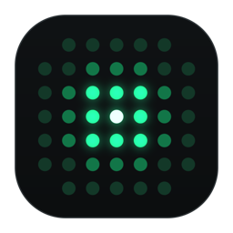

# AGY Swap

**Switch Google Antigravity accounts in one click — without touching OAuth tokens.**<br>
A native macOS and Windows menu-bar instrument and paired CLI, built in Rust with GPUI.

[](#macos)
[](#windows)
[](rust-toolchain.toml)
[](https://github.com/zed-industries/zed/tree/main/crates/gpui)
[](LICENSE)

<p>
  <b><a href="#install">Install</a></b> · <a href="#highlights">Highlights</a> · <a href="#how-it-works">Architecture</a> · <a href="#cli">CLI</a> · <a href="#safety-and-privacy">Safety (R1–R5)</a> · <a href="docs/architecture-tour.md">Isokit Tour</a>
</p>

<br>

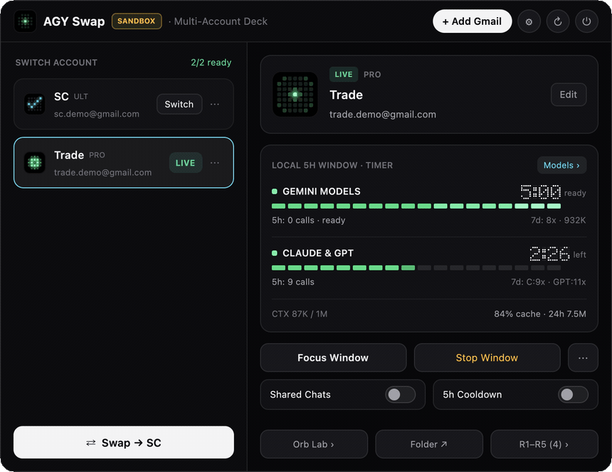

<sub>Native GPU-rendered GPUI popover (no Electron, no WebView, ~4 MB release bundle) — Dark &amp; Light themes, 5h local timers, and per-account PHOSPHOR LED orbs.</sub>

</div>

## What it is

Running multiple Google Antigravity accounts usually means signing out, clearing caches, or juggling fragile shell wrappers. **AGY Swap** sits quietly in your macOS Menu Bar (or Windows System Tray) and launches each account inside its own isolated `--user-data-dir` and home directory while keeping your primary OS profile untouched.

Built with [GPUI](https://github.com/zed-industries/zed/tree/main/crates/gpui) and structured using [`rust-product-skills`](https://github.com/KJ-AIML/rust-product-skills) (`L0`–`L5` layered workspace, zero `unsafe`, zero `.unwrap()`/`panic!`, enforced by `xtask verify`), AGY Swap gives you **honest local telemetry** — real 5-hour rolling reset timers (`H:MM`) and exact 7-day call/token counts from local transcripts — with **zero OAuth token reads** and zero private API scraping.

## Highlights

- **One-click account swapping & parallel sessions.** Switch cleanly between accounts (`Switch Active` closes the previous window and opens the next) or run two accounts side-by-side (`Open Alongside`) with live `LIVE` / `READY` / `5H LIMIT` status detection.
- **Honest local 5-hour rolling timers — never guessed `%`.** Displays hardware dot-matrix countdown clocks (`5:00 ready` → `2:26 left`) and segmented LED bars for **Gemini Models** and **Claude & GPT**, plus exact 5h/7d call counts, token totals, and detected model IDs read purely from local `transcript.jsonl`.
- **Optional Shared Chats & Skills.** Toggle **Shared Chats** per secondary profile to link `.gemini/{antigravity, config, skills}` to your primary profile via POSIX symlinks (macOS) or NTFS directory junctions (Windows), while keeping login vaults and `UserData` strictly isolated.
- **Custom PHOSPHOR LED Orbs per profile.** Pick from 12 GPU-rendered dot-matrix animations (`Analysing`, `Orbital`, `Equalizer`, `Pulse`, `Radar`, `Verified`, …) across 5 phosphor themes per account — or leave on `Auto Status`.
- **Full or Compact layout + Dark & Light themes.** Switch live between **Full (2-Column)** (`680×524`) and **Compact (Switcher Only)** (`320×420`), **Samo Obsidian (Dark)** and **Samo Alabaster (Light)**, plus a one-click **Hide Emails** privacy toggle for screen sharing.
- **Safe Sandbox Mode.** Test every UI page, CLI command, and rotation flow without touching your live Antigravity session via `--sandbox` and `./scripts/test-safe.sh` (macOS) or `.\scripts\test-safe.ps1` (Windows).

<table>
  <tr>
    <td width="50%">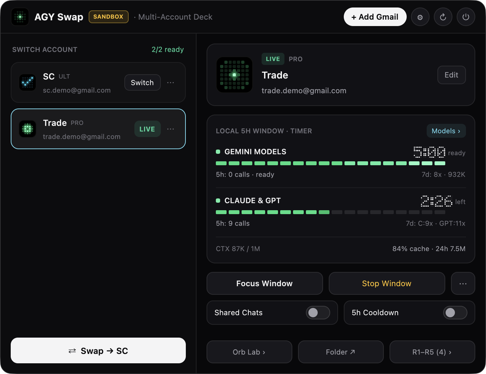</td>
    <td width="50%">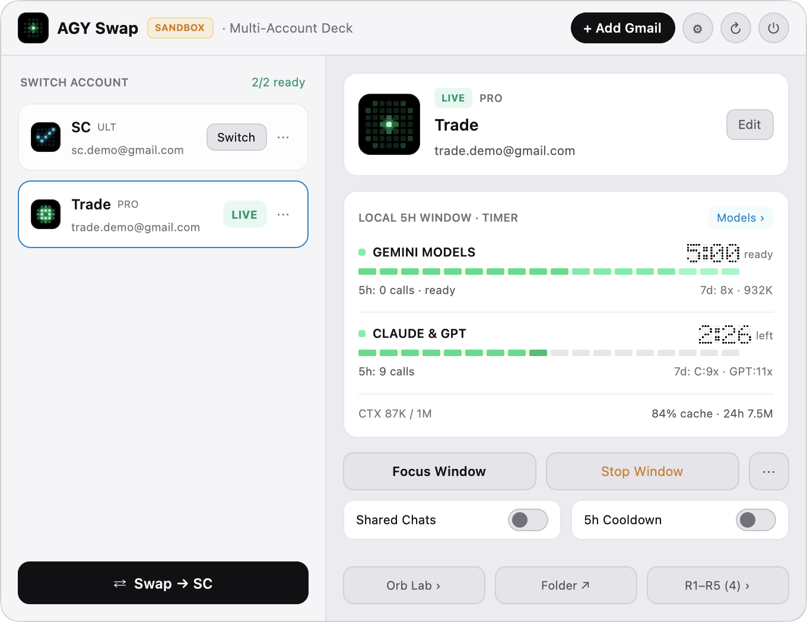</td>
  </tr>
  <tr>
    <td align="center"><sub><b>Overview — Dark (Obsidian)</b> · 5h rolling timers &amp; quick controls</sub></td>
    <td align="center"><sub><b>Overview — Light (Alabaster)</b> · Instant theme switch in Settings</sub></td>
  </tr>
  <tr>
    <td width="50%">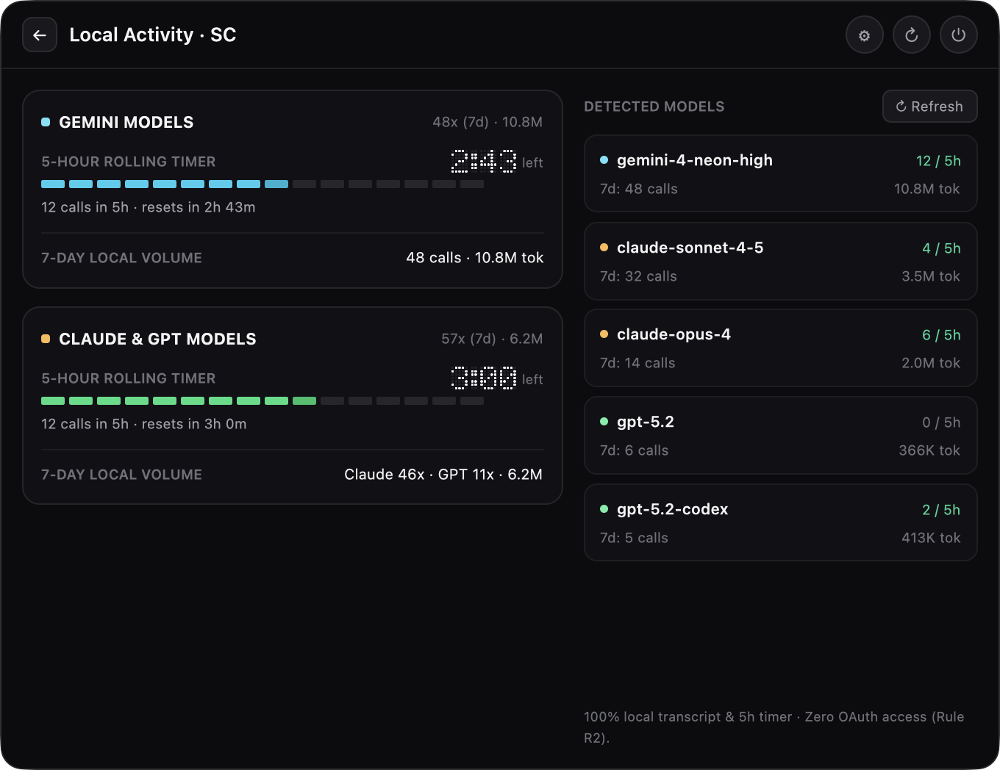</td>
    <td width="50%">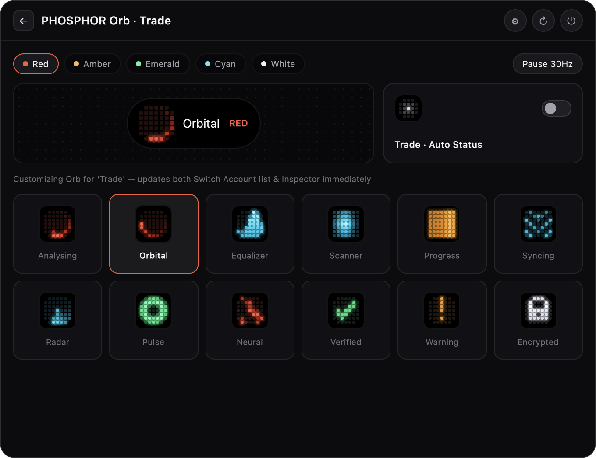</td>
  </tr>
  <tr>
    <td align="center"><sub><b>Local Activity</b> · Exact 5h timers &amp; detected models (zero OAuth)</sub></td>
    <td align="center"><sub><b>PHOSPHOR Orb Lab</b> · Custom per-profile GPU LED matrix</sub></td>
  </tr>
</table>

### Compact mode & App Settings

<table>
  <tr>
    <td width="38%" align="center">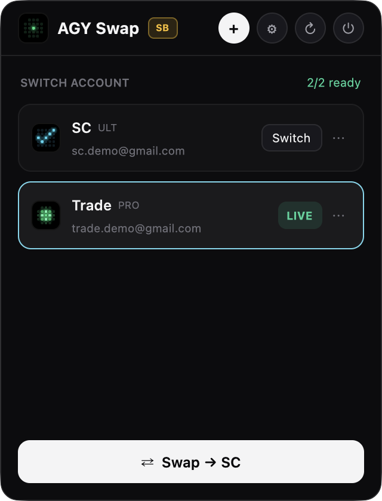</td>
    <td width="62%" align="center">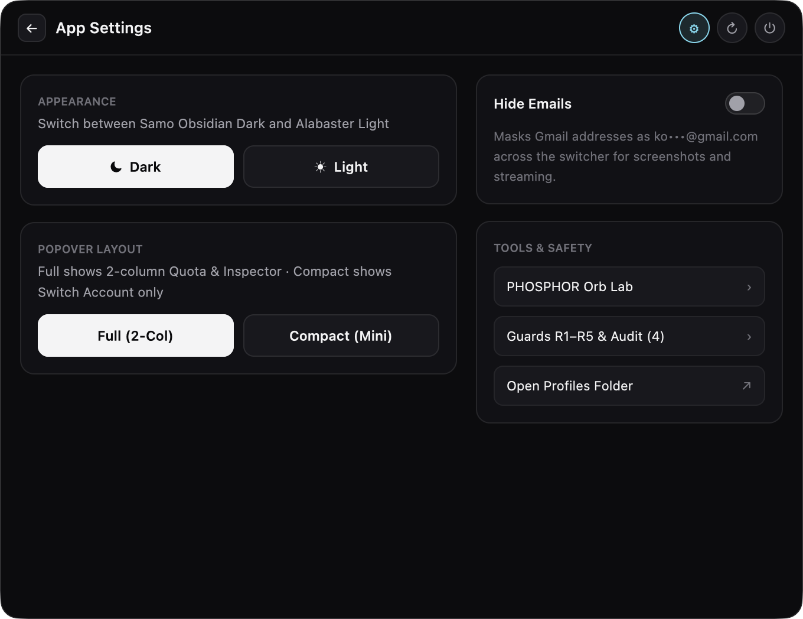</td>
  </tr>
  <tr>
    <td align="center"><sub><b>Compact Mode</b> · Switcher-only deck</sub></td>
    <td align="center"><sub><b>App Settings</b> · Theme, Layout &amp; Hide Emails</sub></td>
  </tr>
</table>

## How it works

Every UI button and CLI command flows through the same `L4 Engine::execute` entrypoint — enforced by `cargo run -p xtask -- verify`.

<p align="center">
  <picture>
    <source media="(prefers-color-scheme: dark)" srcset="docs/media/architecture-isokit-dark.png">
    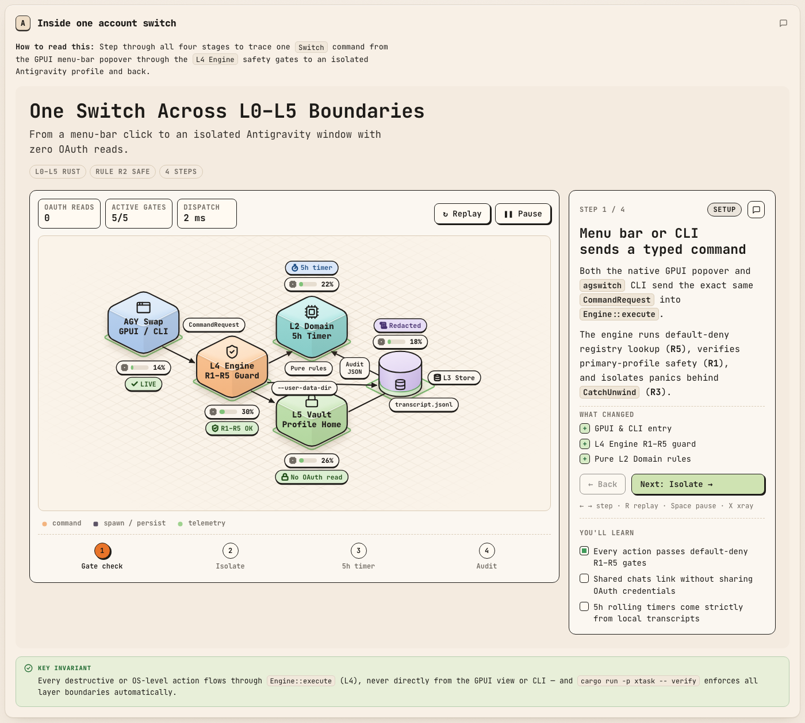
  </picture>
  <br>
  <sub>Interactive isometric architecture built with <a href="https://github.com/KJ-AIML/clarify">Clarify</a> (<code>isokit</code>) — open or render <a href="docs/architecture-tour.md"><code>docs/architecture-tour.md</code></a> to step through all 4 stages.</sub>
</p>

| Layer | Crate | Role |
| :---: | :--- | :--- |
| `L0` | `agswitch-primitives` | Zero-dependency value types (`ProfileId`, `RuleId`, `AccountTier`, `AppError`, `RuntimeOs`) |
| `L1` | `agswitch-spec` | Shared typed commands, snapshots, and `DashboardSnapshot` contracts |
| `L2` | `agswitch-domain` | Pure deterministic logic: rotation policy, `transcript.jsonl` parser, 5h timer math, cmdline matcher |
| `L3` | `agswitch-store` | Atomic JSON persistence for profile metadata, cooldowns, and redacted audit log |
| `L4` | `agswitch-engine` | `Engine::execute`, default-deny `CommandRegistry`, `CatchUnwind` panic boundary, `R1`–`R5` gates |
| `L5` | `agswitch-integrations` | OS adapters: process spawning/matching, POSIX symlinks / Windows NTFS junctions, safe sandbox |
| `App` | `agswitch-desktop` · `agswitch-cli` | Native GPUI Menu Bar / Tray app + paired `agswitch` CLI |

## Install

Pre-built downloads are published on [GitHub Releases](https://github.com/KJ-AIML/agy-swap/releases), or you can build from source.

### macOS

Requires macOS 13+ (Apple Silicon tested), Xcode Command Line Tools (`xcode-select --install`), and [rustup](https://rustup.rs) (toolchain pinned in [`rust-toolchain.toml`](rust-toolchain.toml)).

```sh
git clone https://github.com/KJ-AIML/agy-swap.git
cd agy-swap
./scripts/package-macos.sh --install
```

This compiles `--release` with thin LTO, bundles `AGY Swap.app` (`LSUIElement = true` so it lives cleanly in the Menu Bar with no Dock clutter), builds `dist/AGY-Swap-v0.1.0-macos-arm64.dmg`, signs ad hoc, and installs both `/Applications/AGY Swap.app` and `~/.local/bin/agswitch`.

To run straight from source without installing:
```sh
cargo run --release -p agswitch-desktop          # live mode
cargo run -p agswitch-desktop -- --sandbox       # isolated sandbox (never touches live Antigravity)
```

### Windows

Requires Windows 10/11 (`x86_64`).

**Pre-built:** download `AGY-Swap-v0.1.0-windows-x86_64.zip` from [GitHub Releases](https://github.com/KJ-AIML/agy-swap/releases), check it against `SHA256SUMS-windows-x86_64.txt`, extract it anywhere, and run `AGY Swap\agswitch-desktop.exe`. The app lives in the System Tray (on Windows 11, new tray icons start in the `^` overflow; drag it onto the taskbar to pin it). `AGY Swap\agswitch.exe` is the CLI.

```powershell
(Get-FileHash .\AGY-Swap-v0.1.0-windows-x86_64.zip -Algorithm SHA256).Hash.ToLower()
Get-Content .\SHA256SUMS-windows-x86_64.txt
```

**From source:** requires Visual Studio Build Tools (Desktop development with C++ + Windows SDK) and [rustup](https://rustup.rs) (MSVC toolchain pinned in [`rust-toolchain.toml`](rust-toolchain.toml)).

```powershell
git clone https://github.com/KJ-AIML/agy-swap.git
cd agy-swap
.\scripts\package-windows.ps1 -Install
```

This compiles `--release` with thin LTO, embeds the app icon and version info, builds `dist\AGY-Swap-v0.1.0-windows-x86_64.zip` plus `dist\SHA256SUMS-windows-x86_64.txt`, and (with `-Install`) installs to `%LOCALAPPDATA%\Programs\AGY Swap\` with a Start Menu shortcut. No Administrator rights are needed. Omit `-Install` to only build the zip. If script execution is disabled, run `powershell -ExecutionPolicy Bypass -File .\scripts\package-windows.ps1`.

To run straight from source without installing:
```powershell
cargo run --release -p agswitch-desktop          # live mode
cargo run -p agswitch-desktop -- --sandbox       # isolated sandbox (never touches live Antigravity)
```

<table>
  <tr>
    <td width="50%">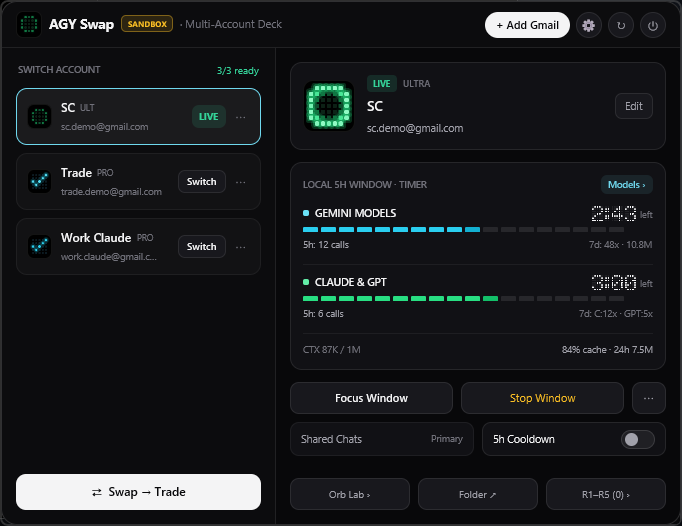</td>
    <td width="50%">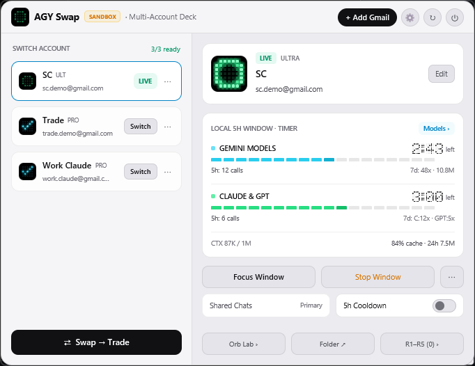</td>
  </tr>
  <tr>
    <td align="center"><sub><b>Windows 11 — Dark</b> · DirectX GPUI popover above the tray</sub></td>
    <td align="center"><sub><b>Windows 11 — Light</b> · sandbox demo data</sub></td>
  </tr>
</table>

## CLI

Both the desktop app and the `agswitch` CLI share the exact same `Engine` and audit trail:

```sh
agswitch status                          # active session, 5h timers, 7d calls/tokens
agswitch status --json                   # machine-readable snapshot
agswitch next                            # smart-rotate to next ready account (skips 5h cooldown)
agswitch switch <profile-id>             # switch active Antigravity window
agswitch open <profile-id>               # open alongside active session
agswitch cooldown <profile-id>           # toggle manual 5h cooldown marker
agswitch share <profile-id> --enabled=true  # toggle Shared Chats symlink/junction
agswitch audit --limit 20                # inspect redacted R1–R5 audit log
```

## Safety and privacy

AGY Swap enforces five non-negotiable engine rules (`R1`–`R5`), verified automatically by unit tests and `./scripts/test-safe.sh`:

| Rule | Guarantee |
| :---: | :--- |
| **R1** | Primary OS Antigravity profile is **never** deleted or login-reset on disk (can only be hidden from the list). |
| **R2** | **Zero OAuth access.** AGY Swap never reads, logs, copies, or transmits Google OAuth tokens or calls private Google APIs. Paths and tokens are scrubbed from the audit log. |
| **R3** | Every command runs behind a `CatchUnwind` panic boundary — no panic can crash the app or corrupt JSON state. |
| **R4** | Destructive actions (deleting an isolated vault on disk, resetting Google login) require explicit confirmation (`--yes` in CLI or modal confirm in UI). |
| **R5** | Default-deny `CommandRegistry` with centralized audit logging for every mutation. |

## Development & verification

```sh
# Full safe verification: layer DAG + purity + clippy (-D warnings) + unit tests + 10 sandbox E2E checks
./scripts/test-safe.sh          # macOS
.\scripts\test-safe.ps1         # Windows (PowerShell)

# Architectural & lint gates only
cargo run -p xtask -- verify
```

## Architecture docs

- [docs/architecture-tour.md](docs/architecture-tour.md) — Interactive Clarify (`isokit`) architecture tour
- [docs/decisions/ADR-001-agswitch-design.md](docs/decisions/ADR-001-agswitch-design.md) — Core design decisions & `R1`–`R5` specification
- [docs/plans/2026-11-24-agswitch-p1-plan.md](docs/plans/2026-11-24-agswitch-p1-plan.md) — Implementation plan & cross-platform considerations

## License

[MIT](LICENSE) — independent open-source utility, not affiliated with or endorsed by Google.
